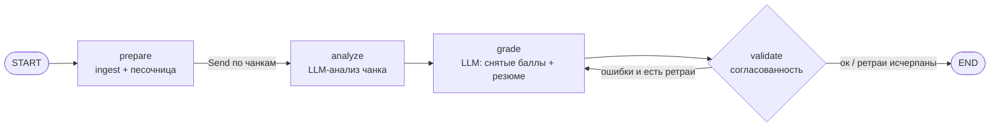

# TaskCheckerAI

Сервис автоматической верификации решений учебных задач по информатике с использованием
LLM (через Ollama) и LangGraph.

На вход сервис принимает:

- **файл или группу файлов** (в том числе один архив `zip`/`tar`/`tar.gz` и ноутбуки `.ipynb`),
- **условие задачи** текстом **или** **эталонное решение** (файл/архив/ноутбук) — достаточно
  одного из двух,
- опционально **эталонный ответ** текстом и **входные данные** для запуска решения,
- опционально **максимальный балл**.

Сервис умеет работать **пакетно**: за один запрос можно загрузить набор работ учеников для
одной задачи/эталона, сравнить всех и получить результат по каждому.

На выходе сервис отдаёт **итоговый балл** и **описание, за что сняты баллы**.

---

## Содержание

- [Как это работает](#как-это-работает)
- [Варианты входа: задача или эталонное решение](#варианты-входа-задача-или-эталонное-решение)
- [Загрузка ноутбуков (.ipynb)](#загрузка-ноутбуков-ipynb)
- [Пакетная проверка (batch)](#пакетная-проверка-batch)
- [Архитектура](#архитектура)
- [Граф проверки (LangGraph)](#граф-проверки-langgraph)
- [Песочница](#песочница)
- [Расчёт балла](#расчёт-балла)
- [API](#api)
- [Swagger / OpenAPI](#swagger--openapi)
- [Конфигурация](#конфигурация)
- [Запуск](#запуск)
- [Веб-интерфейс](#веб-интерфейс)
- [Тесты](#тесты)
- [Безопасность и эксплуатация](#безопасность-и-эксплуатация)
- [Точки расширения](#точки-расширения)

---

## Как это работает

1. **Приём запроса.** FastAPI принимает multipart-запрос: файлы решения, условие задачи
   **или** эталонное решение (файлы/ноутбук), эталонный ответ (опционально), входные данные
   (опционально), максимальный балл (опционально).
2. **Разбор входных данных (ingest, без LLM).** Архивы распаковываются с защитой от
   zip-slip и лимитами по размеру/количеству файлов, ноутбуки `.ipynb` разбираются в
   читаемый текст (текстовые/кодовые ячейки и их выводы, без картинок). Для каждого файла
   определяется кодировка и отсекаются бинарные файлы. Из файлов собирается **контекст
   проекта** (дерево файлов + содержимое в рамках бюджета) и нарезается на **чанки**.
   Отдельно собирается контекст **эталонного решения**.
3. **Запуск решения в песочнице (без LLM).** Определяется точка входа (например `main.py`,
   `solution.py`) и решение запускается изолированно с ограничениями по времени/памяти.
   Вывод программы сравнивается с эталонным ответом. Результат запуска — это «факт» для LLM.
4. **LLM-анализ.** Каждый чанк контекста анализируется моделью **параллельно**
   (`Send` fan-out), результаты склеиваются. Размер промпта (условие + эталон + чанк +
   результат запуска) удерживается в пределах окна модели `LLM_NUM_CTX`: эталонный контекст
   автоматически обрезается, если промпт иначе превысил бы лимит. Для больших ноутбуков
   увеличьте `LLM_NUM_CTX` (модель поддерживает до `32768`).
5. **Оценка.** Модель по условию, эталону, анализу и результатам запуска формирует список
   **снятых баллов** (`deductions`) и резюме. Модель **не** выставляет итоговый балл — его
   считает сервис детерминированно.
6. **Валидация и ретраи.** Результат проверяется на согласованность (нет ли отрицательных
   баллов, пустых причин, суммы больше максимума), точные дубли `deductions` удаляются.
   При ошибке — повторный запрос к модели
   с описанием проблемы (до `GRADE_MAX_RETRIES` раз). Если согласованности добиться не
   удалось — результат «санитизируется» и добавляется предупреждение.
7. **Ответ.** Сервис возвращает балл, максимум, снятые баллы с причинами, резюме,
   результат запуска и предупреждения.

---

## Варианты входа: задача или эталонное решение

Сервис **вариативен** — можно задать источник истины одним из способов:

| Вариант | Как передать | Когда использовать |
|---|---|---|
| **Только текст задачи** | `task="..."` | Есть чёткое условие, эталон не нужен |
| **Эталонное решение** | `reference_files=@etalon.ipynb` (или архив/файлы) | Есть готовое решение преподавателя; условие может быть внутри ноутбука |
| **Оба** | `task` + `reference_files` | Условие отдельно, решение — образец |

Правило простое: **нужно передать хотя бы одно из двух** — `task` или `reference_files`.
Если текста задачи нет, он берётся из **markdown-ячеек эталонного ноутбука** (в
`ML_8_prep_book.ipynb` условие и решение лежат в одном ноутбуке). Дополнительно можно
передать `reference` — короткий эталонный ответ текстом (например, ожидаемый вывод).

Внутри оба источника объединяются в один блок «эталонное решение / эталонный ответ»,
который видит модель на этапах анализа и оценивания.

---

## Загрузка ноутбуков (.ipynb)

Ноутбуки `.ipynb` поддерживаются и для работы ученика, и для эталонного решения. Сервис
разбирает JSON ноутбука (форматы v4 и v3) и превращает его в читаемый текст:

- **ячейки markdown** → текст задачи/пояснений;
- **ячейки кода** → исходный код;
- **выводы** (`stream`, `execute_result`, `display_data`, `error`) → вывод программы,
  таблицы (`text/plain`), текст ошибок;
- **картинки/HTML-графики игнорируются** (base64-изображения не раздувают контекст).

Каждая ячейка помечается, например:

```
[ЯЧЕЙКА 1: текст]
#### 1.1. Задача ...

[ЯЧЕЙКА 2: код]
import pandas as pd
...

[ЯЧЕЙКА 2: вывод]
```

Способы загрузки:

```bash
# одиночный ноутбук как решение ученика
curl -X POST http://127.0.0.1:8000/api/v1/verify \
  -F "reference_files=@ML_8_prep_book.ipynb" \
  -F "files=@student_ml1.ipynb"

# ноутбуки можно класть и внутрь архива — распакуются автоматически
curl -X POST http://127.0.0.1:8000/api/v1/verify \
  -F "task=..." \
  -F "files=@student_works.zip"
```

Запуск решения в песочнице для ноутбуков **не выполняется** (нет точки входа `.py`):
недостаточно данных/зависимостей; оценка идёт по содержимому ячеек и их выводам. Для
notebook-задач это ожидаемое поведение.

---

## Пакетная проверка (batch)

Один запрос — много работ под одну задачу/эталон. Каждый загруженный файл в поле
`submissions` — **отдельная работа**:

- **ноутбук** или **архив** → одна работа;
- несколько файлов группируются по префиксу до `__` или по папке:
  `ivanov__main.py`, `ivanov__utils.py` → работа ученика `ivanov`.

Правила определения ученика (по имени файла):

| Имя файла | Ученик |
|---|---|
| `student_ml1.ipynb` | `student_ml1` |
| `ivanov.zip` | `ivanov` |
| `ivanov__main.py`, `ivanov__utils.py` | `ivanov` (одна работа) |
| `ivanov/main.py` | `ivanov` |

```bash
curl -X POST http://127.0.0.1:8000/api/v1/verify-batch \
  -F "reference_files=@ML_8_prep_book.ipynb" \
  -F "max_score=33" \
  -F "submissions=@ivanov.ipynb" \
  -F "submissions=@petrov.ipynb" \
  -F "submissions=@sidorov.zip"
```

Для пакетной проверки есть и потоковый вариант `/api/v1/verify-batch/stream` (SSE): он
отдаёт события со статусом по каждому ученику, затем итоговые результаты.

---

## Архитектура

```
src/
├── main.py                        # точка входа (uvicorn)
├── config.py                      # настройки (pydantic-settings, .env)
├── static/
│   └── index.html                 # веб-форма загрузки входных данных (Bootstrap)
├── api/
│   ├── app.py                     # фабрика FastAPI + lifespan (инициализация сервиса)
│   ├── schemas.py                 # схемы ответа (в т.ч. batch)
│   └── routes/
│       ├── verify.py              # POST /verify, /verify/stream, /verify-batch, /verify-batch/stream
│       └── health.py              # GET /health
├── core/
│   ├── models.py                  # доменные модели (FileBundle, Deduction, VerificationResult, ...)
│   ├── ingest/
│   │   ├── loaders.py             # файлы/архивы → FileBundle (лимиты, кодировки, zip-slip)
│   │   ├── notebook.py            # .ipynb → читаемый текст (ячейки, выводы, без картинок)
│   │   ├── grouping.py            # группировка работ учеников для batch
│   │   └── context.py             # FileBundle → контекст + чанки
│   └── sandbox/
│       ├── runner.py              # запуск решения (Docker / локальный subprocess)
│       └── compare.py             # сравнение вывода с эталоном
├── llm/
│   ├── factory.py                 # создание модели (Ollama) и structured output
│   └── prompts.py                 # промпты (анализ, оценка, исправление)
├── graph/
│   ├── state.py                   # состояние графа (GraphState)
│   ├── builder.py                 # сборка LangGraph
│   └── nodes/                     # prepare / analyze / grade / validate
└── services/
    └── verification.py            # фасад VerificationService (verify, verify_batch, *_stream)
```

Ключевые принципы:

- **Deterministic vs LLM.** Всё, что можно сделать детерминированно (разбор файлов, запуск,
  сравнение вывода, подсчёт балла, валидация), вынесено из LLM в обычный код. LLM отвечает
  только за смысловой анализ и причины снятия баллов.
- **Ноды — чистые функции над состоянием.** Граф легко расширять новыми нодами
  (например, проверка на плагиат, линтер, тесты).
- **Провайдер LLM за абстракцией** (`llm/factory.py`): сейчас Ollama, смена провайдера —
  правка фабрики/конфигурации.
- **Песочница за протоколом** `SandboxRunner`: реализации `DockerSandbox`, `LocalSubprocessSandbox`,
  `NoSandbox`.

---

## Граф проверки (LangGraph)



- **prepare** — детерминированная нода: разбирает вход, строит контекст и чанки, запускает
  решение в песочнице.
- **analyze** — по одной ноде на чанк, запускаются параллельно через `Send`; результаты
  накапливаются в состоянии благодаря reducer'у.
- **grade** — формирует `deductions` и `summary` (структурированный вывод).
- **validate** — считает балл, проверяет согласованность; маршрутизирует либо обратно в
  `grade` (с текстом ошибок для исправления), либо в `END`.

---

## Песочница

Решение запускается изолированно с ограничениями по времени и памяти.

| Бэкенд | Условие | Особенности |
|---|---|---|
| `docker` | Docker Engine доступен | `--network none`, `--read-only`, `--cap-drop ALL`, `--security-opt no-new-privileges`, непривилегированный `--user`, лимиты RAM/CPU/PIDs, read-only монтирование рабочей папки и tmpfs для `/tmp` |
| `local` | `SANDBOX_ALLOW_LOCAL=true` и (`SANDBOX_BACKEND=local` или Docker недоступен) | Локальный процесс `python <entry>` с таймаутом, лимитом вывода и очищенным окружением; **без изоляции сети и файловой системы** |
| `off` | `SANDBOX_ENABLED=false`, Docker недоступен или local не разрешён | Запуск не выполняется (fail closed), причина видна в `execution.detail` |

Автоматического переключения на `local` больше нет: если Docker недоступен, а
`SANDBOX_ALLOW_LOCAL=false` (по умолчанию), песочница возвращает `skipped` и не выполняет
чужой код. Включайте локальный режим только на доверенной машине и никогда не выставляйте
такой сервис в интернет.

Docker-запуск дополнительно ограничивает вывод (`SANDBOX_OUTPUT_LIMIT_BYTES`), а при
таймауте удаляет контейнер по имени, а не только процесс Docker CLI.

Точка входа определяется по имени файла (приоритет: `main.py`, `solution.py`, `solve.py`,
`program.py`, `task.py`, `app.py`, `run.py`) либо как единственный/первый `.py` в корне.

Вывод программы нормализуется (пробелы, переводы строк) и сравнивается с эталоном; для чисел
используется допуск. Результат запуска (`execution`) передаётся модели как факт.

Все пути загруженных файлов проходят единую проверку: запрещены `..`, абсолютные пути,
Windows drive/UNC-пути, управляющие символы и зарезервированные имена Windows. Дополнительно
перед записью в песочницу проверяется, что итоговый путь остаётся внутри её корня.

---

## Расчёт балла

LLM возвращает только список **снятых баллов**:

```json
{
  "deductions": [
    {"points": 2, "reason": "не обработан пустой ввод"},
    {"points": 1.5, "reason": "дублирование кода в двух функциях"}
  ],
  "summary": "Решение в целом верное, есть замечания по надёжности и стилю."
}
```

Сервис детерминированно считает:

```
score = max_score − Σ deductions.points
```

Это исключает рассогласование «балл ↔ снятия», которое типично для LLM. При
несогласованном ответе (отрицательные/пустые записи, сумма больше максимума) выполняется
повторный запрос, а в крайнем случае — санитизация (обрезка/масштабирование до максимума).

---

## API

### `POST /api/v1/verify`

`multipart/form-data`:

| Поле | Тип | Обяз. | Описание |
|---|---|---|---|
| `files` | file[] | да | Файлы решения, один архив или ноутбук `.ipynb` |
| `task` | string | нет* | Условие задачи |
| `reference` | string | нет | Эталонный ответ текстом |
| `reference_files` | file[] | нет* | Эталонное решение: файлы/архив/ноутбук |
| `max_score` | int | нет | Максимальный балл (по умолчанию из конфига) |
| `stdin_data` | string | нет | Входные данные для запуска решения |

\* Нужно передать хотя бы одно из полей `task` или `reference_files`.

Пример:

```bash
curl -X POST http://127.0.0.1:8000/api/v1/verify ^
  -F "task=Считайте два числа и выведите их сумму" ^
  -F "reference=7" ^
  -F "max_score=10" ^
  -F "stdin_data=3 4" ^
  -F "files=@main.py"
```

Ответ:

```json
{
  "score": 8.0,
  "max_score": 10,
  "deductions": [
    {"points": 2, "reason": "не обработан пустой ввод"}
  ],
  "summary": "Решение в целом верное, замечания по надёжности.",
  "execution": {
    "status": "ok",
    "exit_code": 0,
    "stdout": "7\n",
    "stderr": "",
    "matches_reference": true,
    "detail": "Локальный запуск без изоляции (Docker недоступен)"
  },
  "retries_used": 0,
  "warnings": []
}
```

### `POST /api/v1/verify/stream`

Те же поля, отдаёт прогресс в формате SSE (`prepare`, `analyze`, `grade`, `validate`) и
финальный результат.

### `POST /api/v1/verify-batch`

Пакетная проверка: набор работ учеников под одну задачу/эталон.

`multipart/form-data`:

| Поле | Тип | Обяз. | Описание |
|---|---|---|---|
| `submissions` | file[] | да | Работы учеников (ноутбуки/архивы/файлы, см. [batch](#пакетная-проверка-batch)) |
| `task` | string | нет* | Условие задачи |
| `reference` | string | нет | Эталонный ответ текстом |
| `reference_files` | file[] | нет* | Эталонное решение: файлы/архив/ноутбук |
| `max_score` | int | нет | Максимальный балл |
| `stdin_data` | string | нет | Входные данные для запуска решения |

\* Нужно передать хотя бы одно из полей `task` или `reference_files`.

Ответ:

```json
{
  "max_score": 33,
  "count": 2,
  "students": [
    {
      "student": "ivanov",
      "result": {
        "score": 27.0,
        "max_score": 33,
        "deductions": [{"points": 6, "reason": "..."}],
        "summary": "...",
        "execution": {"status": "skipped", "detail": "..."},
        "retries_used": 0,
        "warnings": []
      },
      "error": null
    },
    {"student": "petrov", "result": null, "error": "Архив повреждён ..."}
  ]
}
```

### `POST /api/v1/verify-batch/stream`

Те же поля, отдаёт SSE-события по каждому ученику (`student_start`, `prepare`, `analyze`,
`grade`, `validate`, финальный `result`) и завершающее `batch_done`.

### `GET /health`

```json
{
  "status": "ok",
  "model": "qwen2.5-coder:7b",
  "sandbox_backend": "local",
  "ollama_available": true
}
```

---

## Swagger / OpenAPI

После запуска сервиса доступна интерактивная документация FastAPI:

| Адрес | Назначение |
|---|---|
| `/docs` | Swagger UI — документация и **Try it out** для проверки запросов |
| `/redoc` | ReDoc — компактная документация |
| `/openapi.json` | OpenAPI-спецификация (JSON) |

У всех эндпоинтов описаны поля, ограничения, коды ошибок и примеры ответов. Чтобы
проверить запрос через Swagger UI:

1. Откройте `POST /api/v1/verify` и нажмите **Try it out**.
2. Загрузите файл решения в поле `files`.
3. Заполните `task` или загрузите `reference_files` — хотя бы одно из двух.
4. Нажмите **Execute** и посмотрите ответ.

Потоковые эндпоинты (`/verify/stream`, `/verify-batch/stream`) возвращают SSE;
их удобнее проверять через `curl --no-buffer`:

```bash
curl -N -X POST http://127.0.0.1:8000/api/v1/verify/stream \
  -F "task=Считайте два числа и выведите их сумму" \
  -F "files=@main.py"
```

Спецификация хранится в репозитории (`docs/openapi.json`), чтобы её можно было
подключить к Postman/Insomnia, использовать в CI и просматривать без запуска
сервиса. Экспорт и проверка актуальности:

```powershell
python scripts/export_openapi.py          # обновить docs/openapi.json
python scripts/export_openapi.py --check  # проверить, что файл актуален
```

Спецификация генерируется из того же приложения FastAPI, поэтому описания в
Swagger UI и в `docs/openapi.json` всегда совпадают.

---

## Конфигурация

Настройки задаются переменными окружения или файлом `.env` (см. `.env.example`).

| Переменная | По умолчанию | Описание |
|---|---|---|
| `OLLAMA_BASE_URL` | `http://localhost:11434` | Адрес Ollama |
| `LLM_MODEL` | `qwen2.5-coder:7b` | Имя модели |
| `LLM_TEMPERATURE` | `0` | Температура генерации |
| `LLM_REQUEST_TIMEOUT` | `300` | Таймаут запроса к LLM, с |
| `LLM_NUM_CTX` | `16384` | Размер окна контекста модели (`num_ctx`) |
| `DEFAULT_MAX_SCORE` | `100` | Максимальный балл по умолчанию |
| `GRADE_MAX_RETRIES` | `2` | Число попыток исправления оценки |
| `MAX_FILES` | `100` | Максимум файлов |
| `MAX_FILE_BYTES` | `524288` | Максимум на файл, байт |
| `MAX_TOTAL_BYTES` | `8388608` | Максимум суммарно, байт |
| `MAX_ARCHIVE_ENTRIES` | `1000` | Максимум записей в архиве |
| `MAX_CONTEXT_CHARS` | `60000` | Бюджет текста контекста |
| `MAX_CHUNK_CHARS` | `15000` | Размер чанка для анализа |
| `MAX_ANALYSIS_CHARS` | `12000` | Бюджет текста анализа для оценщика |
| `SANDBOX_ENABLED` | `true` | Включена ли песочница |
| `SANDBOX_BACKEND` | `docker` | `docker` / `local` |
| `SANDBOX_ALLOW_LOCAL` | `false` | Разрешить небезопасный локальный запуск |
| `SANDBOX_IMAGE` | `python:3.12-slim` | Образ для Docker |
| `SANDBOX_TIMEOUT_SEC` | `15` | Таймаут запуска, с |
| `SANDBOX_MEMORY_MB` | `256` | Лимит памяти, МБ |
| `SANDBOX_OUTPUT_LIMIT_BYTES` | `65536` | Максимум stdout/stderr на поток |
| `SANDBOX_CPUS` | `1.0` | Лимит CPU для контейнера |
| `SANDBOX_PIDS_LIMIT` | `128` | Лимит процессов в контейнере |
| `SANDBOX_TMPFS_MB` | `16` | Размер tmpfs `/tmp` в контейнере |
| `SANDBOX_USER` | `65534:65534` | UID:GID процесса в контейнере |
| `API_HOST` / `API_PORT` | `127.0.0.1` / `8000` | Адрес сервера |
| `API_KEY` | пусто | Если задан, `/api/v1/*` требует заголовок `X-API-Key` |
| `RATE_LIMIT_PER_MINUTE` | `0` | Лимит запросов на IP в минуту (`0` — выключен) |

---

## Запуск

Требования: Python 3.12, [Ollama](https://ollama.com), опционально Docker.

```powershell
# 1. Зависимости
cd src
python -m pip install -r requirements.txt

# 2. Модель
ollama pull qwen2.5-coder:7b

# 3. (опционально) конфигурация
Copy-Item .env.example .env

# 4. Запуск сервера
python main.py
# веб-интерфейс:   http://127.0.0.1:8000/
# OpenAPI (Swagger): http://127.0.0.1:8000/docs
```

Если Docker недоступен, песочница **не** переключается на локальный режим автоматически:
запуск будет пропущен (`off`). Чтобы явно разрешить локальный subprocess-режим, задайте
`SANDBOX_BACKEND=local` и `SANDBOX_ALLOW_LOCAL=true` — только на доверенной машине.

### Docker

В репозитории есть `Dockerfile`, `.dockerignore` и `docker-compose.yml`.

Собрать образ:

```bash
docker build -t taskcheckerai:latest .
```

Запустить контейнер (Ollama должна быть доступна с хоста; модель уже загружена):

```bash
# Docker Desktop (Windows/macOS)
docker run --rm -p 8000:8000 taskcheckerai:latest

# Linux — дать контейнеру доступ к хосту
docker run --rm -p 8000:8000 ^
  --add-host=host.docker.internal:host-gateway ^
  taskcheckerai:latest
```

Либо через Compose:

```bash
docker compose up --build
```

Веб-интерфейс: `http://127.0.0.1:8000/`. Настройки передаются переменными окружения,
например `docker run -e OLLAMA_BASE_URL=http://host.docker.internal:11434 -p 8000:8000 taskcheckerai:latest`.

> **Песочница в контейнере.** Внутри образа нет доступа к Docker-демону. Образ собран
> с безопасным значением `SANDBOX_ALLOW_LOCAL=false`, поэтому обычный `docker run`
> не выполняет код ученика (`sandbox_backend=off` в `/health`). `docker-compose.yml`
> явно включает локальный режим (`SANDBOX_BACKEND=local`, `SANDBOX_ALLOW_LOCAL=true`):
> решение запускается локальным `python` внутри контейнера (без изоляции). Docker-изоляция
> доступна только при запуске сервиса без контейнера (см. выше). Не публикуйте
> compose-развёртывание в интернет без внешней изоляции.

---

## Веб-интерфейс

Корневая страница `GET /` отдаёт HTML-форму (Bootstrap) для загрузки входных данных —
`src/static/index.html`. Возможности:

- переключатель режима **Одна работа / Пакет**;
- поля: текст задачи, эталонный ответ, эталонное решение (файлы/архив/`.ipynb`);
- загрузка файлов решения или набора работ учеников (drag & drop);
- максимальный балл и входные данные (`stdin`);
- индикаторы состояния сервиса (модель, песочница, доступность Ollama);
- наглядный вывод результата: балл с прогресс-баром, снятые баллы, резюме и запуск в
  песочнице; для пакета — сводная таблица по ученикам со средним баллом.

Страница обращается к тем же эндпоинтам `/api/v1/verify` и `/api/v1/verify-batch`.

---

## Тесты

```powershell
cd src
python -m pytest
```

Покрыты: разбор файлов/архивов и ноутбуков `.ipynb`, path traversal и Windows-пути,
лимиты распаковки, песочница (fail closed, лимит вывода, таймаут), изоляция ошибок batch,
группировка работ, сравнение вывода, валидация и санитизация оценки, граф на фейковых
моделях, HTTP-слой (в т.ч. `/verify-batch`, ошибки LLM и SSE), API-ключ, rate limit,
OpenAPI-схема и доступность страниц `/docs` и `/redoc`.

Дополнительно есть интеграционные скрипты (требуют запущенную Ollama):

```powershell
python -m tests.e2e_smoke   # сервис напрямую
python -m tests.e2e_api     # через HTTP (TestClient)
```

---

## Безопасность и эксплуатация

- При локальном запуске `API_HOST=127.0.0.1` — сервис доступен только с этой машины.
- Для сетевого доступа задайте `API_KEY`: все `/api/v1/*` будут требовать заголовок
  `X-API-Key`. Ключ можно ввести в Swagger UI через кнопку **Authorize**.
- `RATE_LIMIT_PER_MINUTE` ограничивает число запросов с одного IP (in-memory, на один
  процесс). Для нескольких реплик используйте reverse proxy или Redis.
- Ограничивайте размер HTTP-тела на уровне reverse proxy (nginx `client_max_body_size`,
  Traefik buffering) в дополнение к `MAX_TOTAL_BYTES`.
- Не включайте `SANDBOX_ALLOW_LOCAL=true` на машине, где выполняется недоверенный код.
  Docker-режим использует `--network none`, read-only rootfs, `--cap-drop ALL`,
  `no-new-privileges`, непривилегированного пользователя и лимиты ресурсов.
- Код ученика отправляется в Ollama. Если Ollama или LangSmith tracing настроены на
  внешний сервис, данные покидают машину — учитывайте это в политике хранения.
- Для публичного развёртывания используйте HTTPS, аутентификацию, лимиты запросов и
  отдельный sandbox-сервис (gVisor/Firecracker) без доступа к Docker-сокету.

---

## Точки расширения

- **Новый LLM-провайдер** — правка `llm/factory.py` и `LLM_MODEL` в конфиге.
- **Новая проверка** — добавить ноду в `graph/nodes/` и ребро в `graph/builder.py`
  (например, запуск тестов, линтер, проверка на плагиат).
- **Новый язык запуска** — расширить `core/sandbox/runner.py` (сейчас исполняется Python).
- **Рубрика/критерии** — сейчас оценивание опирается на условие и эталон; веса/критерии
  можно добавить как данные в промпт и в `validate`.
- **Персистентность графа** — добавить Postgres/Redis-чекпоинтер; для stateless-проверок
  он намеренно не используется, чтобы не накапливать состояние запросов в памяти.
